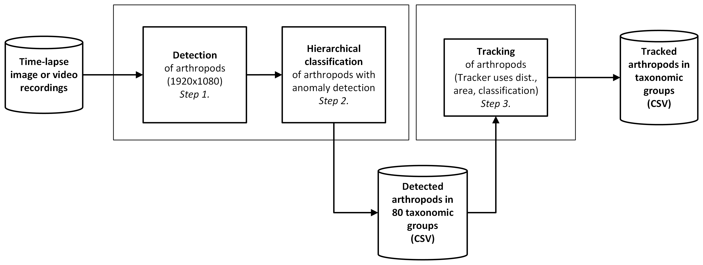
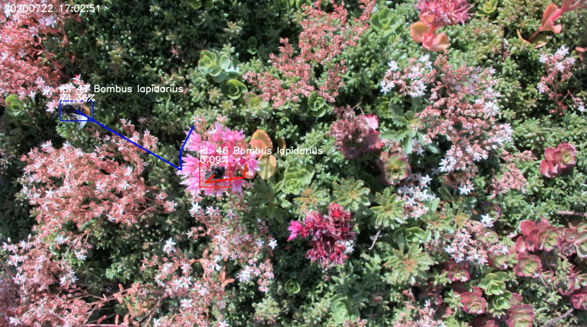
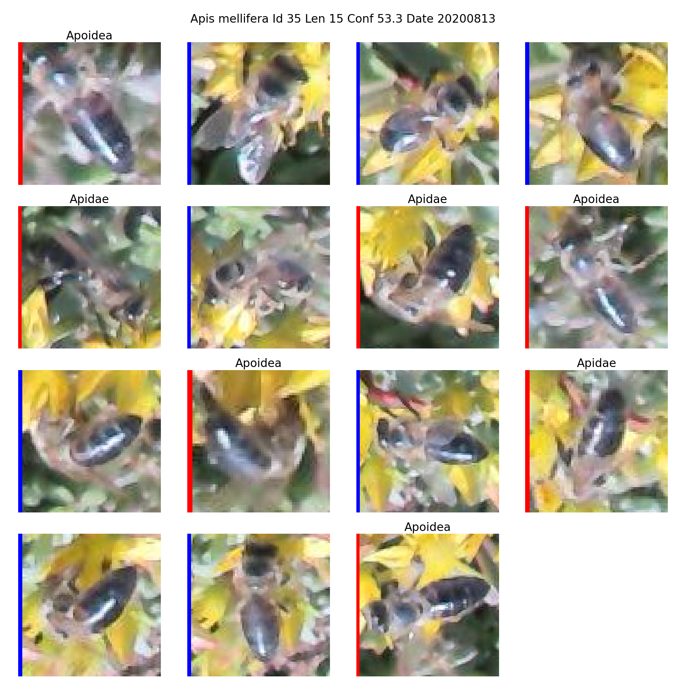
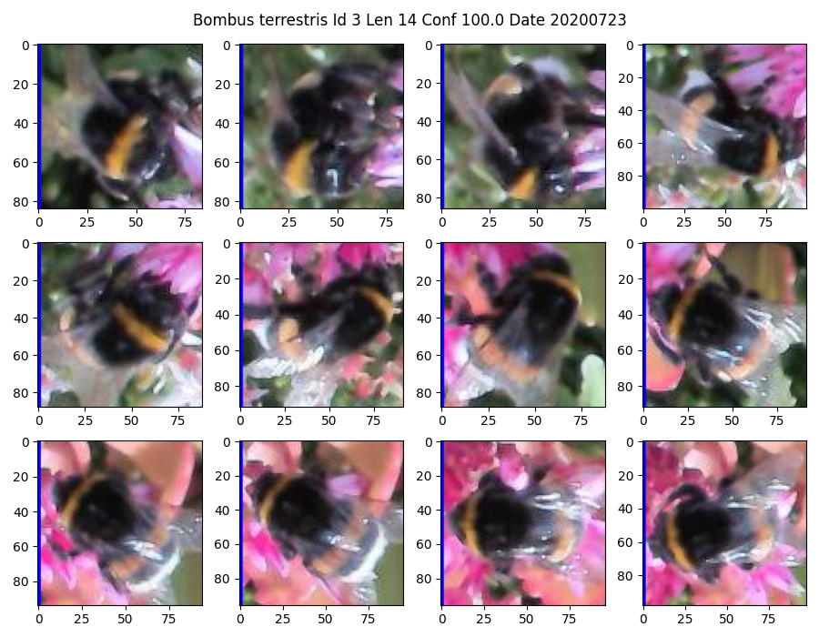

# InsectDCT

**InsectDCT** is a Python-based pipeline for detecting, hierarchically classifying, and tracking insects in time-lapse camera-trap images and video recordings. It is designed for natural and semi-natural floral environments, where vegetation, changing illumination, and complex backgrounds make automated monitoring challenging.



The pipeline combines three main stages:

1. **Detection and localization** — detects arthropods with YOLO11. Motion-Informed Enhancement (MIE) can help improve detection in challenging backgrounds.
2. **Hierarchical taxonomic classification** — classifies (ConvNext-Base) detected animals across taxonomic levels, from broad groups to family, genus, or species where supported by the model.
3. **Tracking** — associates detections across frames in high-temporal-resolution recordings to follow individual insects over time.

The repository includes inference scripts, graphical interfaces, browser-based viewers, crop-generation utilities, model-training helpers, and tools for inspecting detection and tracking results.

## Contents

- [Publication and datasets](#publication-and-datasets)
- [Example](#example)
- [Requirements and environments](#requirements-and-environments)
- [Model weights and labels](#model-weights-and-labels)
- [Getting started](#getting-started)
- [Command-line usage](#command-line-usage)
- [Output files](#output-files)
- [Taxonomic labels](#taxonomic-labels)
- [Training and development tools](#training-and-development-tools)
- [Repository version tags](#repository-version-tags)
- [Related publications](#related-publications)

## Publication and datasets

The complete pipeline and dataset are described in:

Kim Bjerge, Simon Wogram, Pau Enric Serra-Marin, and Toke T. Høye, “InsectDCT: A generalised pipeline for detection, taxonomic classification, and tracking of insects in camera-trap recordings” (2026, bioRxiv).

- **Preprint:** https://doi.org/10.64898/2026.07.07.736939
- **V6 training and test datasets:** https://zenodo.org/records/21154490

## Example

The example below shows two *Bombus lapidarius* bumblebees visiting flowering *Sedum* plants. Tracking is most useful for high-temporal-resolution recordings (approximately 0.33–1 frames per second). For more widely spaced time-lapse images, intervals of around 30–60 seconds are typical.



[Watch the insect-tracking video on YouTube](https://www.youtube.com/watch?v=obxTmgERpO4).

For detection, full-resolution images are resized to 1920 × 1080 pixels before processing with YOLO11. Detected insects are cropped using rectangular bounding boxes and resized to 128 × 128 pixels for CV6 or 224 × 224 pixels for CV7 classification models.

## Requirements and environments

Choose the environment setup that matches your platform:

- **Windows or Linux:** `README-conda-env-yolo11.txt` describes the Anaconda environment requirements.
- **Raspberry Pi 4/5:** `raspberryPiEnv.sh` creates and installs the Python virtual environment.

## Model weights and labels (Hierarchical classifier)

The model weights, labels, and thresholds are distributed separately from the source code. Download the required files from the links below and extract them into `models_save/`.

The models were trained on images collected using Wingscapes Bird cameras, Logitech webcams, and Raspberry Pi cameras. Backgrounds include *Sedum*, red clover, sea rocket, common mallow, and various grasses.

- **V3 — `HierarchicalClassifierV3_05092025`:** trained on the camera images described above and supplemented with GBIF data.  
  https://drive.google.com/file/d/1zA22fWHYrmV-PKOHmddPX2OmHwxvxDb7/view?usp=drive_link
- **V4 — `HierarchicalClassifierV4_05092025`:** trained on the same images as V3, but without GBIF data.  
  https://drive.google.com/file/d/1ca2XaNygAE3UUUMkZtGWvmoy20AuaTHl/view?usp=sharing
- **V5 — `HierarchicalClassifierV5_05092025`:** based on V3, supplemented with Raspberry Pi camera images of challenging species.  
  https://drive.google.com/file/d/1VFzGcx1WDyL91ATu4CVR7HUR_nwjpZum/view?usp=drive_link
- **V6 — `HierarchicalClassifierV6` (paper version/default):** based on V5, with reduced vegetation representation, a reorganized dataset, and additional images of challenging species.  
  https://drive.google.com/file/d/1V8uWDIjT1DHo3CyxRjOk6vZYkeBjKX_0/view?usp=drive_link
- **V7 — `HierarchicalClassifierV7`:** based on V6 and supplemented with additional Lepidoptera species, Raspberry Pi HQ camera images, and short video clips.  
  https://drive.google.com/file/d/15oGWBgp3S08k8VK0r2qzMC65uUBFvsPh/view?usp=sharing

Pi HQ video recordings are also discussed in the paper by Serra-Marin et al.: https://doi.org/10.1111/2041-210X.70165.

## Getting started

1. Clone or download this repository, preserving its directory structure.
2. Download the model weights, labels, and thresholds from the links above, then extract them into `models_save/`.
3. Install the dependencies using `README-conda-env-yolo11.txt` (Anaconda) or, on Raspberry Pi 4/5, follow the instructions in `raspberryPiEnv.sh`.
4. Activate the Anaconda environment, if applicable:

   ```bash
   conda activate yolo11
   ```

5. Launch the graphical interface:

   ```bash
   python smartInsectGUI.py
   ```

### Programs available in the launcher

The **Smart AI Insect Program Launcher** provides access to eight tools:

| Tool | Script or file | Purpose |
|---|---|---|
| Insect Detector and Classifier | `pipeDetectAndClassifyInsectsGUI.py` | Runs YOLO detection and hierarchical classification. |
| Insect Tracker | `pipeTrackInsectsGUI.py` | Tracks detections from `*-CL.csv` files. |
| Insect Crop Generator | `createCropsGUI.py` | Generates image crops from classified detections. |
| Insect Track Generator | `createTrackCropsGUI.py` | Creates plots of tracked insects from `*-TRS.csv` files. |
| Open Insect Viewer in Browser | `insect_viewer.html` | Views detected insects and their taxonomic classifications. |
| Open Track Viewer in Browser | `track_viewer.html` | Views tracked insects from `*-TR.csv` files. |
| Open Insect Crops Viewer in Browser | `insect_crops_viewer.html` | Views image crops from classified detections. |
| Open Track Crops Viewer in Browser | `track_crops_viewer.html` | Views image crops associated with tracks and taxa. |

The first four tools can also be run from the command line.

## Command-line usage

Sample images are available in `./images`. The examples below show common options; consult each script's source code for additional parameters.

### Detect and classify insects

The detector/classifier script supports both images and videos.

```bash
# Run using the default device/model settings
python pipeDetectAndClassifyInsectsTaxon.py

# Run on the CPU
python pipeDetectAndClassifyInsectsTaxon.py --device cpu

# Process images in a specified directory
python pipeDetectAndClassifyInsectsTaxon.py --images "./project/images/"

# Set the directory for result files
python pipeDetectAndClassifyInsectsTaxon.py --resultsDir "./project/detections/"

# Use the optimized NCNN option on the CPU
python pipeDetectAndClassifyInsectsTaxon.py --device cpu --optimized ncnn

# Read timestamps from EXIF metadata rather than filenames
python pipeDetectAndClassifyInsectsTaxon.py --useExifTime True

# Use EfficientNetV2S for classification
python pipeDetectAndClassifyInsectsTaxon.py --modelType EfficientNetV2S

# Use the V7 classification dataset/model
python pipeDetectAndClassifyInsectsTaxon.py --dataset V7
```

By default, the script performs detection and classification using ConvNeXt-Base on `CUDA:0`. The `--device cpu` option runs on the CPU. `EfficientNetV2S` is a smaller, faster classification model, with lower accuracy than ConvNeXt-Base according to the project documentation. For Raspberry Pi, the original README recommends using a YOLO11s model by changing the `--yoloWeights` parameter in the source code when using the NCNN option.

When `--useExifTime True` is enabled, image timestamps are read from EXIF metadata instead of the filename. Supported filename patterns include `CAM1_YYYY_MM_DD_HH_MM_SS.jpg` and `CAM1_YYYYMMDDHHMMSS_...jpg`.

### Detect and classify insects without resizing large images

```bash
# Run detector and classifier using Slicing Aided Hyper Inference (SAHI) tiling for large images
# 20% overlap with 1920x1080 slices 
# Slow performance but increases recall for detecting small insects in very large images
python pipeDetectAndClassifyInsectsTaxonSahi.py --useSahi True
```

### Track insects across frames

The tracker uses detection/classification CSV output (`*-CL.csv`) and is intended for recordings with frame rates from 0.25 to 24 fps.

```bash
# Track detections from the default directories
python pipeTrackInsectsTaxon.py

# Specify source images, detection files, and output directory
python pipeTrackInsectsTaxon.py \
  --images "./project/images/" \
  --detections "./project/detections" \
  --tracks "./project/tracks"

# Restrict tracking to detections with compatible taxonomic classifications
python pipeTrackInsectsTaxon.py --checkTaxa True
```

For video-only workflows, YOLO can perform detection and tracking using ByteTrack or BoT-SORT, followed by hierarchical classification:

```bash
python pipeTrackAndClassifyInsectsTaxon.py
```

See the scripts for additional options:

- https://github.com/kimbjerge/insectDCT/blob/main/pipeDetectAndClassifyInsectsTaxon.py
- https://github.com/kimbjerge/insectDCT/blob/main/pipeTrackInsectsTaxon.py

### Generate insect crops and track plots

```bash
# Create crops from classified detections
python createCrops.py \
  --CSVfiles "./detections/" \
  --imagesPath "./images/" \
  --cropsPath "./crops/"

# Create plots of tracked insects and their image crops
python createTrackCrops.py \
  --validConfTH 20 \
  --tracks "./tracks" \
  --images "./images" \
  --resultsDir "./trackCrops"
```

`createCrops.py` sorts cropped images into directories based on the `*-CL.csv` files. `createTrackCrops.py` creates plots of tracked insects using the `*-TRS.csv` files.

## Output files

### Detection and classification CSV: `*-CL.csv`

Each row represents a detection. The file typically contains the following columns:

```text
year,trapDir,date,time,detectConf,detectId,x1,y1,x2,y2,fileName,taxaLabel,taxaId,taxaLevel,taxaConf,taxaSure,frameId
```

- `trapDir`: source directory path (described in the original format as `subdir3/subdir2`).
- `detectConf`: confidence score from the YOLO11 arthropod detector.
- `detectId`: detector class ID; the original documentation states this is always `0`.
- `x1,y1,x2,y2`: upper-left and lower-right coordinates of the detected arthropod's bounding box.
- `fileName`: image path/name, for example `subdir1/name.JPG`.
- `taxaLabel`: predicted taxonomic label at the order, family, genus, or species level.
- `taxaId` and `taxaLevel`: numeric taxon identifier and hierarchy level.
- `taxaConf`: classifier confidence score (0–100%).
- `taxaSure`: `True` when the confidence is within the training-data distribution and the classification is considered valid.
- `frameId`: frame identifier used to match the detection with detailed information in the corresponding `*-HI.csv` file.

Example rows:

```csv
2024,FR02_Bagnas/Cam.A.2024.07.02,20240407,141529,48,0,2018,212,2112,270,101_WSCT/WSCT0441.JPG,Unsure,0,0,0,False,441
2024,FR02_Bagnas/Cam.A.2024.07.02,20240407,141629,43,0,1262,1123,1355,1224,101_WSCT/WSCT0442.JPG,Syrphidae,37,2,6,True,442
2024,FR02_Bagnas/Cam.A.2024.07.02,20240407,142529,62,0,778,1650,893,1716,101_WSCT/WSCT0451.JPG,Sphaerophoria scripta-complex,73,3,45,True,451
```

### Hierarchical classification CSV: `*-HI.csv`

This file stores detailed hierarchical classifier information for each detection.

```text
Label1,LabelId1,Logit1,Conf1,Above1,Label2,Logit2,LabelId2,Conf2,Above2,Label3,Logit3,LabelId3,Conf3,Above3,Checked,frameId
```

For each level (`1`, `2`, and `3`), the label, label ID, logit, confidence score, and `Above` flag describe the classifier output. `AboveX` is `True` when the confidence score is within the training-data distribution. `Checked` indicates whether the predicted labels are consistent with the taxonomic hierarchy.

### Track summary CSV: `*-TR.csv`

Each row represents a track.

```text
id,startdate,starttime,endtime,duration,class,counts,confidence,size,distance,alternative
```

- `id`: track identifier.
- `class`: taxonomic label assigned to the track.
- `counts`: number of detections in the track (at least two detections are required).
- `confidence`: number of detections predicted as the track's class relative to all detections in that track, as described in the original documentation.
- `size`: average pixel size of the tracked insect.
- `distance`: distance travelled in pixels.
- `alternative`: second-best taxon estimate, when at least two detections support the alternative class.

Example:

```csv
0,20250221,11:57:31,11:58:23,52,Megachile,18,36.8,3199,3171,Apoidae
1,20250221,11:58:07,11:58:31,24,Megachile,12,53.9,2686,1364,Unsure
```

### Track detection CSV: `*-TRS.csv`

Each row represents a detection belonging to a track.

```text
id,date,time,taxaConf,taxaLabel,xc,yc,x1,y1,width,height,detectLine,fileName,frameId
```

- `taxaConf`: taxonomic confidence score.
- `detectLine`: corresponding row/line number in the detection CSV.
- `frameId`: frame number, starting at 1; particularly relevant for video recordings.

Example:

```csv
0,20250221,115731,0.0,Unsure,1331,632,1307,600,49,64,1,pi2_2025_02_21_11_57_31.jpg,23
0,20250221,115732,21.13,Megachile,1310,674,1285,640,50,68,2,pi2_2025_02_21_11_57_32.jpg,24
0,20250221,115734,0.72,Andrena,1278,700,1252,682,52,37,3,pi2_2025_02_21_11_57_34.jpg,25
```

## Taxonomic labels

The V6 hierarchical classifier contains 80 labels at level 3. V7 contains 104 level-3 labels.

- V6 labels: https://github.com/kimbjerge/insectDCT/blob/main/hierarchicalB3L/datasetV6.txt
- V7 labels: https://github.com/kimbjerge/insectDCT/blob/main/hierarchicalB3L/datasetV7.txt
- Detection and classification metrics (precision, recall, and F1 score) for the validation and test datasets: https://github.com/kimbjerge/insectDCT/tree/main/metrics

The V6 taxonomic labels are listed below as documented in the original README. Some labels at lower levels repeat broader groups or include custom categories.

### Level 1 — 19 groups

```text
1 Aranaea
2 Birds
3 Coleoptera
4 Dermaptera
5 Diptera
6 Hemiptera
7 Herpetofauna
8 Hymenoptera_bees
9 Hymenoptera_nobees
10 Isopoda
11 Larvae
12 Lepidoptera
13 Lepidoptera_fw
14 Milipedes
15 Odonata
16 Orthoptera
17 Slugs
18 Snails
19 Vegetation
```

### Level 2 — 39 groups

```text
1 Acrididae
2 Apidae
3 Apoidae
4 Aranaea
5 Birds
6 Bombyliidae
7 Cantharidae
8 Chrysididae
9 Coccinellidae
10 Coleoptera
11 Crabronidae
12 Dermaptera
13 Diptera
14 Formidicidae
15 Hemiptera
16 Herpetofauna
17 Hesperidae
18 Ichneumonidae
19 Isopoda
20 Larvae
21 Lepidoptera
22 Lepidoptera_fw
23 Lycenidae
24 Megachilidae
25 Milipedes
26 Moths
27 Nymphalidae
28 Nymphalidae_fw
29 Odonata
30 Orthoptera
31 Pieridae
32 Pompilidae
33 Sarcophagidae
34 Slugs
35 Snails
36 Syrphidae
37 Tettigoniidae
38 Vegetation
39 Vespidae
```

### Level 3 — 80 groups

```text
1 Acrididae
2 Aglais io
3 Aglais urticae
4 Aglais urticae_fw
5 Anthidium oblongatum
6 Aphantopus hyperantus
7 Apis mellifera
8 Apoidea
9 Apoidea red_abdomen
10 Apoidea reddish
11 Apoidea small
12 Apoidea striped
13 Aranaea
14 Birds
15 Bombus
16 Bombus hypnorum
17 Bombus lapidarius
18 Bombus pascuorum
19 Bombus sylvarum
20 Bombus terrestris
21 Bombyliidae
22 Chorthippus
23 Chrysididae
24 Chrysotoxum
25 Coccinella septempunctata
26 Coenonympha pamphilus
27 Coleoptera
28 Crabronidae
29 Decticus verrucivorus
30 Dermaptera
31 Diptera
32 Episyrphus balteatus
33 Eristalis
34 Eupeodes
35 Eurimyia
36 Formidicidae
37 Helophilus
38 Hemiptera
39 Herpetofauna
40 Hesperidae
41 Ichneumonidae
42 Isopoda
43 Larvae
44 Lepidoptera
45 Lepidoptera_fw
46 Lycaena phlaeas
47 Lycenidae
48 Maniola jurtina
49 Maniola jurtina_fw
50 Megachilidae
51 Melanargia galathea
52 Meliscaeva cinctella
53 Milipedes
54 Moths
55 Myathropa florea
56 Nomada
57 Nymphalidae
58 Odonata
59 Odynerus spinipes
60 Omocestus viridulus
61 Orthoptera
62 Pholidoptera griseoaptera
63 Pieridae
64 Platycheirus
65 Pompilidae
66 Rhagonycha fulva
67 Sarcophagidae
68 Satyrinae_fw
69 Scaeva
70 Scaeva pyrastri
71 Slugs
72 Snails
73 Sphaerophoria scripta-complex
74 Syritta pipiens
75 Syrphidae
76 Syrphus
77 Vegetation
78 Vespidae
79 Vespula vulgaris
80 Xanthogramma
```

## Training and development tools

The detector and classifier training datasets are not included in this repository. The original README states that they may be published separately.

### Motion-Informed Enhancement (MIE) dataset helpers

- `tools/createAccurateDataset.py`
- `tools/Create_MotionNI-dataset.py`

### Python helper modules

- `common/` — helper code used by `pipeDetectAndClassifyInsectsTaxon.py`.
- `idac/` — helper code used by `pipeTrackInsectsTaxon.py`.

### Train and validate YOLO11 detectors

- `insectsColorTrain.py` — train on color images.
- `insectsColorVal.py` — validate on color images.
- `insectsMotionTrain.py` — train on motion-enhanced images.

### Train and validate hierarchical classifiers

- `hierarchicalB3L/trainAdv.py` — train the hierarchical classifier.
- `hierarchicalB3L/validate.py` — validate the hierarchical classifier.
- `hierarchicalB3L/plotTrainAdvResults.py` — plot training results and estimate the mean and standard deviation of logits for classes in the hierarchy.

### Additional analysis and dataset helpers

- `plotResultsInsectTaxon.py`, `plotResultsMAMBO.py`, and `plotResultsNI2.py` — read detection or track CSV files and plot taxon histograms and abundance summaries.
- `countLabels.py` — count YOLO labels in annotated and unannotated datasets.
- `tools/Create-MotionNI-dataset.py` — example for creating motion-enhanced images.
- `tools/Create-PollNI-dataset.py` — select detection images from the Pollinator Watch project (Logitech camera).
- `tools/Create-Orchard-dataset.py` — select detection images from the Orchard project (Raspberry Pi camera).
- `tools/Create-*.py` — scripts for selecting images and videos from various projects.
- `tools/createAccurateDataset.py` — dataset helper associated with the paper “Accurate detections and identification …”: https://doi.org/10.1371/journal.pstr.0000051
- `README_detection_datasets.txt` — additional information about insect-detection datasets: https://github.com/kimbjerge/insectDCT/tree/main/README_detection_datasets.txt
- `copySelectedCrops.py` — select taxa-specific insect crops to build classifier-training datasets (MAMBO, NI2).
- `createCrops.py` — create crops of insects detected and classified by the pipeline.
- `countCrops.py` — count crops and summarize false arthropod (`FalseA`) and false background (`FalseB`) detections.
- `countCropsOrchard.py` — count crops and summarize validated crops for V3 and V4; results include `Test-HierarchicalClassifierVx.csv` (micro- and macro-precision).
- `createTrackCrops.py` — create 3 × 4 plots of insect crops for valid tracks in `*_TRS.csv` files.





## Related publications

- **Object detection with Motion-Informed Enhancement (MIE):** “Object Detection of Small Insects in Time-Lapse Camera Recordings.” https://www.mdpi.com/1424-8220/23/16/7242
- **Flower-cover estimation and arthropod classification:** “A deep learning pipeline for time-lapse camera monitoring of floral environments and insect populations.” https://doi.org/10.1016/j.ecoinf.2024.102861
- **Hierarchical taxonomic classification:** “Hierarchical classification of insects with multitask learning and anomaly detection.” https://doi.org/10.1016/j.ecoinf.2023.102278
- **Tracking at low frame rates:** “Towards edge processing of images from insect camera traps.” https://doi.org/10.1002/rse2.70007

## Repository version tags

Repository tags use the format `DVx-CVy-SVz.z`:

- `DVx` — detector version, e.g. `DV5` for a YOLO11 detector trained on dataset version 5.
- `CVx` — hierarchical classifier version, e.g. `CV6` for the classifier trained on taxonomic dataset version 6.
- `SVx.z` — source-code version, e.g. `SV1.5` for the Python and HTML source code.
